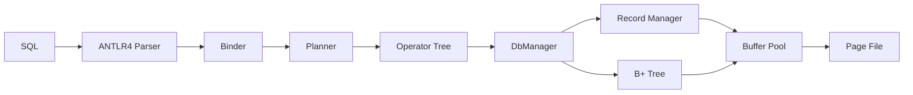

# LJCDB

LJCDB 是一个使用 C++20 从零实现的单机关系数据库原型，覆盖分页存储、缓冲管理、记录管理、磁盘 B+ 树、完整性约束、SQL 解析、查询规划和火山模型执行器。

项目面向数据库系统课程实践，不依赖现成数据库内核。表和索引均持久化在分页文件中，查询执行时按需读取页面，不会把整张表或整棵 B+ 树一次性装入内存。当前版本已通过课程公开评测的全部 **80/80** 测试。

详细设计、页面布局和算法说明见 [项目总结报告](report.md)。

## 功能概览

| 类别 | 已支持功能 |
| --- | --- |
| 数据库 | `CREATE/DROP DATABASE`、`USE`、`SHOW DATABASES` |
| 表 | `CREATE/DROP TABLE`、`DESC`、`SHOW TABLES` |
| 数据操作 | 多行 `INSERT`、`UPDATE`、`DELETE`、CSV 批量导入 |
| 数据类型 | `INT`、`FLOAT/DOUBLE`、`CHAR/VARCHAR`、`DATE`、`NULL` |
| 索引 | B+ 树、普通/唯一/主键索引、单列/组合索引、范围扫描 |
| 约束 | `NOT NULL`、默认值元数据、主键、组合主键、外键、组合外键、`UNIQUE` |
| 查询 | 投影、比较、`IN`、`LIKE`、NULL 判断、多表连接 |
| 进阶查询 | 聚合、`GROUP BY`、`ORDER BY`、`LIMIT/OFFSET`、非相关子查询 |
| 查询优化 | 谓词下推、索引扫描、BNLJ、INLJ、Top-K |
| 使用方式 | 交互模式、评测批处理模式、启动时直接导入文件 |

## 系统架构



查询层采用 `Open / Next / Close` 拉取模型。规划器可以建立以下算子：

- `SeqScan`、`IndexScan`
- `Filter`、`Project`、`Limit`
- 块嵌套循环连接 `BNLJ`
- 索引嵌套循环连接 `INLJ`
- 内存排序与 Top-K
- 哈希聚合

## 环境要求

- Windows 10/11、Linux 或 macOS
- CMake 3.20 或更高版本
- 支持 C++20 和 `<format>` 的现代 C++ 编译器：Visual Studio 2022、MinGW-w64 GCC 13+、GCC 13+ 或 Clang 17+
- Git（仅克隆项目时需要）

ANTLR4 生成的 C++ 解析器和 ANTLR4 C++ runtime 已包含在仓库中，正常构建不需要 Java，也不需要另外安装 ANTLR。

## 快速开始

### 1. 构建（Linux/macOS）

克隆仓库并进入项目根目录后执行：

```bash
cmake -S . -B build -DCMAKE_BUILD_TYPE=Release
cmake --build build --parallel
```

可执行文件生成在：

```text
build/bin/ljcdb
```

### 2. 构建（Windows）

使用 Visual Studio 2022：

```powershell
cmake -S . -B build/windows-msvc -G "Visual Studio 17 2022" -A x64
cmake --build build/windows-msvc --config Release --parallel
```

或者使用 MinGW-w64：

```powershell
cmake -S . -B build/windows-mingw -G "MinGW Makefiles" -DCMAKE_BUILD_TYPE=Release
cmake --build build/windows-mingw --parallel
```

两种工具链都会把程序生成到：

```text
build\windows-msvc\bin\ljcdb.exe
build\windows-mingw\bin\ljcdb.exe
```

Windows 构建默认静态链接工具链的 C/C++ 运行库，以便直接复制单个 `ljcdb.exe` 使用。若需要动态运行库，可在配置时添加 `-DLJCDB_STATIC_WINDOWS_RUNTIME=OFF`。

### 3. 启动交互模式

请从项目根目录运行程序，因为数据库文件默认保存在当前目录下的 `data/` 中。

```bash
./build/bin/ljcdb
```

Windows PowerShell：

```powershell
.\build\windows-msvc\bin\ljcdb.exe
```

SQL 语句可以跨行输入，以分号结束。输入 `exit` 或 `EXIT` 退出。

```sql
CREATE DATABASE DEMO;
USE DEMO;
SHOW TABLES;
```

### 4. 批处理模式

```bash
./build/bin/ljcdb -b < script.sql
```

Windows `cmd.exe`：

```bat
build\windows-msvc\bin\ljcdb.exe -b < script.sql
```

批处理模式使用课程评测约定的表头、数据、错误信息和 `@` 结束标志。

## SQL 示例

下面的脚本可以直接在交互模式中执行。当前语法要求 SQL 关键字使用大写形式。

### 创建表和约束

```sql
CREATE DATABASE SCHOOL;
USE SCHOOL;

CREATE TABLE DEPARTMENT (
    D_ID INT NOT NULL,
    D_NAME VARCHAR(32) NOT NULL,
    PRIMARY KEY (D_ID),
    UNIQUE (D_NAME)
);

CREATE TABLE STUDENT (
    S_ID INT NOT NULL,
    S_NAME VARCHAR(40) NOT NULL,
    D_ID INT,
    SCORE DOUBLE,
    ENROLL_DATE DATE,
    PRIMARY KEY (S_ID),
    FOREIGN KEY (D_ID) REFERENCES DEPARTMENT (D_ID)
);
```

### 插入、修改和删除

```sql
INSERT INTO DEPARTMENT VALUES
    (1, 'Database'),
    (2, 'Compiler');

INSERT INTO STUDENT VALUES
    (1001, 'Alice', 1, 92.5, '2026-09-01'),
    (1002, 'Bob',   1, 86.0, '2026-09-01'),
    (1003, 'Carol', 2, NULL, '2026-09-02');

UPDATE STUDENT SET SCORE = 90.0 WHERE S_ID = 1002;
DELETE FROM STUDENT WHERE S_ID = 1003;
```

### 索引与范围查询

```sql
ALTER TABLE STUDENT ADD INDEX IDX_SCORE (SCORE);
SHOW INDEXES;

SELECT S_ID, S_NAME, SCORE
FROM STUDENT
WHERE SCORE >= 85.0 AND SCORE < 95.0
ORDER BY SCORE DESC;

ALTER TABLE STUDENT DROP INDEX IDX_SCORE;
```

### 聚合、连接与分页

```sql
SELECT DEPARTMENT.D_ID, DEPARTMENT.D_NAME, COUNT(*), AVG(STUDENT.SCORE)
FROM STUDENT, DEPARTMENT
WHERE STUDENT.D_ID = DEPARTMENT.D_ID
GROUP BY DEPARTMENT.D_ID
ORDER BY DEPARTMENT.D_ID ASC;

SELECT S_ID, S_NAME, SCORE
FROM STUDENT
ORDER BY SCORE DESC
LIMIT 10 OFFSET 0;
```

### 模糊查询和子查询

```sql
SELECT S_ID, S_NAME
FROM STUDENT
WHERE S_NAME LIKE 'A%';

SELECT S_ID, S_NAME
FROM STUDENT
WHERE D_ID = (
    SELECT D_ID
    FROM DEPARTMENT
    WHERE D_NAME = 'Database'
);

SELECT S_ID, S_NAME
FROM STUDENT
WHERE D_ID IN (
    SELECT D_ID
    FROM DEPARTMENT
    WHERE D_NAME LIKE '%a%'
);
```

## CSV 批量导入

SQL 形式：

```sql
LOAD DATA INFILE '/absolute/path/students.csv'
INTO TABLE STUDENT
FIELDS TERMINATED BY ',';
```

也可以在启动时指定数据库、表和文件：

```bash
./build/bin/ljcdb \
    --database SCHOOL \
    --file /absolute/path/students.csv \
    -t STUDENT
```

当前 CSV 快速导入格式为：

- 无表头，每行对应一条记录；
- 字段顺序必须与 Schema 一致；
- 分隔符固定为逗号；
- 字符串和日期不加 SQL 单引号；
- NULL 字段写作 `NULL`；
- 不支持带引号字段、字段内逗号、转义和字段内换行。

与上面 `STUDENT` 表对应的示例文件：

```csv
1004,David,1,88.5,2026-09-03
1005,Eve,2,NULL,2026-09-03
```

## 命令行参数

| 参数 | 作用 |
| --- | --- |
| `-b`、`--batch` | 使用评测批处理输出格式 |
| `-d NAME`、`--database NAME` | 启动时打开数据库 |
| `-f PATH`、`--file PATH` | 启动时导入指定 CSV 文件 |
| `-t TABLE` | 指定启动时导入的目标表 |
| `--init` | 清空 `data/` 下的全部数据库并退出 |

> [!WARNING]
> `--init` 会递归删除当前项目 `data/` 目录中的全部数据库文件，且不能恢复。

## 持久化文件

数据库默认保存在：

```text
data/<database>/
├── .catalog
├── .index
├── .foreign
├── <table>_<id>.ljcdb
└── <table>_<index-id>.index
```

- 表文件第 0 页保存表元数据，其余页面保存定长槽记录；
- 索引文件第 0 页保存 B+ 树元数据，其余页面保存内部节点和叶节点；
- 记录文件与索引文件共享一个 6000 页框的缓冲池；
- 页大小为 8192 字节。

不要在数据库运行期间手工修改这些文件。

## 项目目录

```text
.
├── CMakeLists.txt
├── SQL.g4
├── main.cpp
├── execute.cpp / execute.h
├── parse.h
├── query.cpp / query.h
├── system_management.cpp / system_management.h
├── record_management.h
├── index_management.h
├── fileio/
├── bufmanager/
├── parser/generated/
├── third_party/
├── test/
└── report.md
```

## 测试结果

项目包含文件、记录、索引、系统管理和查询规划的回归测试源码，位于 `test/`。B+ 树测试会主动降低节点容量，从而高频触发分裂、借位、合并、根收缩和页面复用等边界情况。

最终版本通过课程公开评测全部 **80/80**，包括：

- 数据库、表和大规模数据导入；
- 基本查询与增删改；
- 主键、外键、组合约束及索引；
- 大表索引查询和双表连接；
- 四表、五表连接及索引优化；
- 聚合、分组、模糊匹配、子查询、排序分页；
- `DATE`、`UNIQUE` 和 `NULL`。

更完整的测试分类和实现分析见 [report.md](report.md#12-测试与实验结果)。

## 当前限制

- SQL 关键字需要大写。
- WHERE 条件目前只支持 `AND`，不支持通用 `OR` 和 `NOT` 表达式。
- 不支持表别名和自连接，FROM 中的重复表会被拒绝。
- 子查询仅支持非相关标量比较和 `IN`。
- `VARCHAR` 在逻辑上保存实际字符串，但底层采用声明长度的定长物理槽。
- 排序和哈希聚合尚未实现磁盘溢写。
- 尚未实现事务、WAL、并发控制和崩溃恢复。
- Planner 使用启发式规则，没有统计信息和完整成本模型。
- CSV 导入器面向课程数据格式，不是完整的通用 CSV 解析器。

## 第三方组件与许可

项目包含 ANTLR 4.13.2 C++ runtime，其许可文本位于 [`third_party/antlr4-cpp-runtime-4.13.2-source/LICENSE.txt`](third_party/antlr4-cpp-runtime-4.13.2-source/LICENSE.txt)。生成的 Lexer 和 Parser 位于 `parser/generated/`。

仓库当前没有单独的顶层项目许可证。在公开分发、接受贡献或允许他人复用项目前，应根据预期用途补充合适的 `LICENSE` 文件。

## 更多文档

- [完整项目总结报告](report.md)
- [SQL 文法](SQL.g4)
- [构建配置](CMakeLists.txt)
- [记录管理](record_management.h)
- [B+ 树索引](index_management.h)
- [查询执行与规划](query.h)
