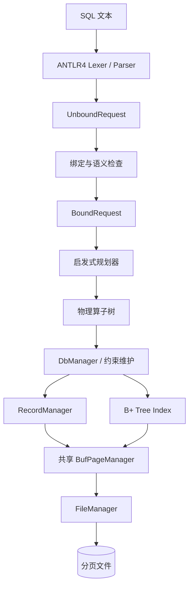

# LJCDB 数据库系统项目总结报告

## 摘要

LJCDB 是一个使用 C++20 实现的单机关系数据库原型。项目从课程提供的页式文件与缓冲管理框架出发，依次实现了定长记录管理、磁盘 B+ 树索引、数据库与表目录管理、完整性约束、SQL 解析、名称与类型绑定、物理计划生成、火山模型执行器以及命令行前端，最终形成了从 SQL 文本到持久化数据读写的完整执行链路。

系统支持 `INT`、`FLOAT/DOUBLE`、`VARCHAR/CHAR` 和 `DATE`，支持数据库与表的创建删除、批量导入、增删改查、普通索引与组合索引、主键、外键、唯一约束、NULL、模糊查询、聚合与分组、排序分页、非相关子查询以及多表连接。查询规划器能够根据条件选择顺序扫描或索引范围扫描，并在多表等值连接中选择索引嵌套循环连接，否则退化为块嵌套循环连接。

项目已通过课程公开评测的全部 80 分测试。除了功能正确性，本项目的主要工作还包括：把全部存储结构落在分页文件中、维护 B+ 树完整删除逻辑、为复合键生成可扫描区间、在有限内存下压缩排序物化数据，以及打通解析、绑定、规划、执行和输出之间的数据结构。

## 1. 项目目标与实现范围

本项目的目标不是包装已有数据库，而是自行完成一个小型关系数据库的核心路径：

1. 使用页式文件系统持久化表与索引，而不是把整张表或整棵索引树常驻内存。
2. 在记录层提供稳定的 RID，并支持记录的插入、读取、更新、删除与遍历。
3. 在索引层实现可持久化的 B+ 树，支持单列和多列、多种数据类型、非唯一和唯一索引。
4. 在系统层管理数据库、表、索引和外键元数据，并维护各类约束。
5. 将 SQL 语句解析为结构化请求，完成名称解析、类型检查和语义检查。
6. 将绑定后的查询转换成算子树，以流式接口执行，并进行基本的启发式优化。
7. 提供交互模式和符合课程评测协议的批处理模式。

### 1.1 已实现功能

| 类别 | 功能 |
| --- | --- |
| 数据库管理 | `CREATE/DROP DATABASE`、`USE`、`SHOW DATABASES` |
| 表管理 | `CREATE/DROP TABLE`、`DESC`、`SHOW TABLES` |
| 数据操作 | 多行 `INSERT`、带条件的 `DELETE` 和 `UPDATE`、CSV 批量导入 |
| 数据类型 | `INT`、`FLOAT/DOUBLE`、`CHAR/VARCHAR`、`DATE`、`NULL` |
| 索引 | 普通索引、唯一索引、主键索引、组合索引、范围扫描 |
| 完整性约束 | `NOT NULL`、默认值元数据、主键、组合主键、外键、组合外键、`UNIQUE` |
| 基本查询 | 投影、比较过滤、`IN`、`IS NULL`、`IS NOT NULL`、`LIKE` |
| 进阶查询 | 多表连接、聚合、`GROUP BY`、`ORDER BY`、`LIMIT/OFFSET`、非相关子查询 |
| 查询优化 | 谓词下推、索引范围扫描、块嵌套循环连接、索引嵌套循环连接、Top-K |
| 前端 | ANTLR4 SQL 解析、交互输出、批处理输出、错误码与耗时输出 |

### 1.2 项目结构

| 文件或目录 | 职责 |
| --- | --- |
| `fileio/` | 页式文件读写、文件标识管理 |
| `bufmanager/` | 缓冲页、页表、脏页写回与 LRU 替换 |
| `record_management.h` | 表 Schema、数据页布局和记录管理 |
| `index_management.h` | 分页 B+ 树及范围迭代器 |
| `system_management.h/.cpp` | 目录、表、索引、约束、序列化与批量导入 |
| `query.h/.cpp` | 请求绑定、查询算子、规划器和 DML 执行器 |
| `SQL.g4`、`parse.h` | SQL 文法和解析树 Visitor |
| `execute.h/.cpp` | 请求分发、结果输出和批处理协议 |
| `main.cpp` | 命令行参数、交互循环、异常边界 |
| `test/` | 文件、记录、索引、系统与查询规划测试 |
| `tools/generate_dbs_dataset.py` | 生成公开测试所需的 TPC-H SF=0.3 投影数据 |

## 2. 总体架构

系统按职责分成前端、查询处理、系统管理和存储四个部分。上层只通过稳定接口使用下层，不直接依赖磁盘布局。



一条 `SELECT` 的主路径为：

```text
SQL 文本
  -> 语法树
  -> 未绑定请求（名字仍为字符串）
  -> 绑定请求（表名、列名变成稳定 ID，并完成类型检查）
  -> 物理算子树
  -> Open / Next / Close 拉取元组
  -> 流式格式化输出
```

DDL 和 DML 请求同样由解析器产生，但在绑定后分别交给系统管理接口或 DML 执行器。这样既避免解析器直接操作存储，也避免存储层理解 SQL 语义。

## 3. 页式文件与缓冲管理

### 3.1 页式文件

系统页大小为 8192 字节。文件管理器将 `(file_id, page_id)` 映射到磁盘文件中的固定偏移，所有表文件和索引文件都通过页接口访问。上层模块不会一次性读入整张表或整棵 B+ 树。

页式访问有两个作用：一是让记录和索引能够处理明显大于可用内存的数据；二是将磁盘 I/O 的单位固定为页，为缓存命中、脏页写回和替换策略提供统一基础。

### 3.2 缓冲池

当前缓冲池包含 6000 个页框，理论数据区约为 46.875 MiB。缓冲管理器使用哈希表定位 `(file_id, page_id)`，用栈式 LRU 结构选择替换页，并为每个页框维护脏页标记。发生淘汰或关闭数据库时，脏页才会写回磁盘。

记录文件和索引文件共享同一个 `BufPageManager`。共享缓冲池有两点好处：

- 可以由同一个替换策略在表页和索引页之间动态分配缓存，不会出现一侧空闲而另一侧频繁淘汰的问题；
- 同一物理页只存在一份缓存映射，关闭文件时可统一刷新并失效对应页。

缓存管理器提供的核心操作包括：

| 接口 | 含义 |
| --- | --- |
| `getPage` | 命中时返回缓存页，未命中时选择页框并从磁盘读入 |
| `allocPage` | 为新文件页分配缓存页，可选择是否读取原内容 |
| `access` | 更新页面的替换状态 |
| `markDirty` | 标记页面已修改并更新访问状态 |
| `writeBack` | 必要时写回一个页框并移除映射 |
| `flushFile` | 写回指定文件的所有脏页 |
| `flushAndInvalidateFile` | 写回并清除指定文件的全部缓存映射 |

## 4. 记录管理

### 4.1 Schema 与记录格式

`Schema` 持久化保存记录总长度、NULL 位图长度、列数、各列偏移、列描述和默认值区。每个列描述包含列名、类型、物理长度、可空性和默认值位置。系统在打开或创建表时检查列数、名字、类型、偏移单调性、记录长度以及默认值边界，避免错误元数据导致越界读写。

一条记录采用如下定长布局：

```text
+-------------------+----------+----------+-----+----------+
| NULL bitmap       | column 0 | column 1 | ... | column n |
+-------------------+----------+----------+-----+----------+
| ceil(n / 8) bytes |  fixed-width physical slots          |
+-------------------+---------------------------------------+
```

其中 `INT` 和 `DATE` 使用 4 字节，`FLOAT/DOUBLE` 使用 8 字节，字符串使用声明的最大长度。字符串在逻辑层表现为实际长度不同的 `VARCHAR` 值，但物理层仍使用定长槽：写入时补零，读取时在声明长度内寻找结尾。这种方案牺牲了部分空间利用率，但让任意列都可由 Schema 偏移直接定位，明显简化了更新、RID 稳定性和索引键提取。

NULL 不占用对应类型的特殊取值，而是记录在行首位图中。查询层反序列化后，当前实现使用 `Value` 变体中的 `bool(false)` 作为 NULL 哨兵；系统本身不提供 SQL 布尔类型，因此不会与普通布尔值混淆。

### 4.2 数据页布局

表文件第 0 页保存 `TableMeta`，包括空闲页链表头、已分配数据页数量和 Schema。其余页面为数据页：

```text
+----------------------+----------------------+--------------------------+
| page meta (12 bytes) | slot bitmap          | fixed-size record slots  |
+----------------------+----------------------+--------------------------+
| capacity / used /    | 1 bit per slot       | slot 0, slot 1, ...      |
| next free page       |                      |                          |
+----------------------+----------------------+--------------------------+
```

槽容量按下面的上界计算，其中 `P` 是页大小，`R` 是记录长度：

```text
slot_capacity = floor(8 * (P - 12) / (8 * R + 1))
```

该公式同时为记录区和每槽 1 bit 的位图预留空间。插入时从空闲页链表头选择页面并扫描位图中的第一个空槽；页面填满后将其从空闲链表移除。删除使满页重新出现空槽时，再把页面接回空闲链表。

### 4.3 RID 与遍历接口

RID 使用 64 位无符号整数，高 32 位为页号，低 32 位为槽号：

```text
RID = (page_id << 32) | slot_id
```

记录移动不会发生，因此索引叶子中保存的 RID 能稳定定位表记录。记录管理器的主要接口如下：

| 接口 | 作用 |
| --- | --- |
| `InsertRecord` | 寻找空闲槽并写入记录，返回 RID |
| `LoadRecord` | 根据 RID 读取记录字节 |
| `UpdataRecord` | 保持 RID 不变，原地覆盖记录 |
| `EraseRecord` | 清除槽位并维护空闲页链表 |
| `FirstRecord` / `NextRecord` | 按数据页和槽号遍历有效记录 |
| `isValid` | 检查 RID 页号、槽号和槽位图 |

## 5. B+ 树索引

### 5.1 设计目标

索引实现位于独立分页文件中。一次查询只读取从根到叶的路径以及范围扫描经过的叶页，不需要将整棵树装入内存。索引同时支持：

- 单列或多列复合键；
- `INT`、`DOUBLE`、定长字符串和 `DATE`；
- 可重复键、唯一键和包含 NULL 的唯一键；
- 点查、开闭区间范围查找和叶子链表遍历；
- 插入分裂、删除借位、合并、根收缩和空闲页复用。

### 5.2 索引元数据与页面布局

第 0 页保存 `BPTMeta`：根页、叶链表头尾、空闲页链表头、最大页号、唯一标记、键列数、各列类型及键内偏移。树创建时根节点同时也是叶节点。

普通索引页的前 16 字节是页面元数据：

```text
type | count | prev | succ
```

`type` 区分叶节点、内部节点和空闲页。叶节点中的 `prev/succ` 构成双向链表；空闲页复用 `succ` 字段连接空闲链表。

叶节点条目为：

```text
[serialized key][record RID]
```

内部节点条目为：

```text
[maximum key in child subtree][RID tie-breaker][child page id]
```

与常见“分隔键 + n+1 个孩子”的画法不同，本实现为每个孩子保存该子树的最大 `(key, RID)`。搜索时找到第一个不小于目标的最大键；若目标大于本节点全部最大键，则进入最后一个孩子。这种布局让父项与孩子一一对应，但要求孩子最大值变化时沿最右路径向上传播。

设序列化键长度为 `K`，则叶条目长度为 `K + 8`，内部条目长度为 `K + 12`，页面容量分别为：

```text
leaf_capacity     = floor((PAGE_SIZE - 16) / (K + 8))
internal_capacity = floor((PAGE_SIZE - 16) / (K + 12))
```

### 5.3 复合键与比较规则

索引键采用“NULL 位图 + 各索引列定长字节”的格式。比较从第一个索引列开始逐列进行；只有当前列相等时才比较下一列，全部键列相等后再比较 RID。RID 作为最终比较项，使非唯一索引中的重复键仍具有严格全序。

当前比较规则将 NULL 排在所有非 NULL 值之前。唯一索引仅在键中不含 NULL 时拒绝重复，因此能够保留 SQL 中“多个 NULL 不互相冲突”的语义；主键则由系统层额外拒绝 NULL。

复合索引遵循最左前缀规则。例如索引为 `(a, b, c)`：

- `a = 1 AND b = 2 AND c >= 3` 可以构造完整有效区间；
- `a = 1 AND b >= 2` 可以使用前两列，后续列用类型极值补齐；
- 只有 `b = 2` 时不能直接利用该索引定位，因为缺少第一列边界。

### 5.4 查询与范围迭代器

树内搜索在每个节点内二分查找，因此点查的页访问复杂度为 `O(h)`，其中 `h` 为树高。`SearchRange` 先定位左端点，再返回 `SearchIter`。迭代器保存当前叶页、槽号、右边界、开闭信息和记录 RID；`Next` 在页内递增，到页尾后沿 `succ` 进入下一叶页。

范围扫描的复杂度为：

```text
O(h + number_of_matching_entries)
```

由于叶子页互相链接，后续记录不需要反复从根搜索。链表头尾存放在元数据页中。分裂保留原左页、合并保留左侧页，因此最左页的 PID 不变，`lhead` 通常无需改写；最右页发生分裂或向左合并时更新 `ltail`，同时修复相邻页的 `prev/succ`。

### 5.5 插入

插入过程如下：

1. 对唯一且不含 NULL 的键先执行同键检查。
2. 从根开始二分下降，保存完整搜索路径。
3. 叶页未满时在有序位置插入；若插入改变叶页最大值，则向上传播。
4. 叶页已满时，将原条目和新条目放入临时连续区，分成左右两页并修复叶链表。
5. 把左右孩子的新最大项写入父节点；父节点满时继续分裂。
6. 根节点分裂时创建新内部根，树高增加一层。

### 5.6 删除与页面回收

删除首先精确定位 `(key, RID)`。若删除后节点仍满足最小占用率，只需在必要时更新祖先保存的最大值。发生下溢时依次尝试：

1. 从左兄弟借最后一个条目；
2. 从右兄弟借第一个条目；
3. 与左兄弟合并；
4. 否则与右兄弟合并。

内部节点使用相同思路递归再平衡。根内部节点只剩一个孩子时，唯一孩子成为新根。被合并释放的页面不会缩短文件，而是进入空闲页链表，后续分裂优先复用，避免频繁扩大索引文件。

删除实现中最容易出错的是三类边界：删除叶页最后一项后的最大值传播、最右叶向左合并时的 `ltail` 更新，以及内部节点借位后父项最大键的更新。本实现将这些情况分别放在叶层调整、`_updatemax` 和 `_rebalance` 中处理。

## 6. 系统管理与完整性约束

### 6.1 目录组织

每个数据库对应 `data/` 下的一个目录：

```text
data/<database>/
├── .catalog       # 表目录
├── .index         # 索引目录
├── .foreign       # 外键目录
├── <table>_<id>.ljcdb
└── <table>_<index-id>.index
```

内存中的 `DbManager` 为表、索引和外键维护稳定 ID、位图以及按名字和 ID 查询的哈希映射。打开数据库时从三个目录文件恢复元数据并打开对应分页文件；关闭数据库时刷新目录和缓冲池。

### 6.2 表、索引和外键对象

- `Table` 保存表 ID、表名、记录管理器、文件名、主键索引 ID 和列名到列号的映射。
- `Index` 保存索引 ID、名字、所属表、索引列号序列、唯一性、隐式索引标记、索引类型和 B+ 树管理器。
- `Foreign` 保存父子表 ID，以及父表唯一索引和子表辅助索引的 ID。

主键和唯一约束直接建立在唯一 B+ 树上。建立外键时，父表引用列必须由可用于存在性检查的唯一索引支持，子表引用列则由隐式索引支持，以加速插入检查和父行删除/更新检查。

### 6.3 约束维护

插入一行时依次进行：

1. 行宽、字段类型和字符串长度检查；
2. `NOT NULL` 与日期合法性检查；
3. 主键非空和唯一性检查；
4. 普通唯一索引冲突检查；
5. 外键目标存在性检查；
6. 插入记录并维护全部索引。

若索引插入过程中失败，已插入的索引项会逆序删除，同时删除刚插入的记录，避免表数据与索引立即失配。

删除和更新拆成 `Valid` 与 `Apply` 两阶段。验证阶段检查外键、非空、唯一性和类型等条件；应用阶段才更新索引和记录。更新索引时先插入新键、再删除旧键；若中途失败，会尽量恢复已经处理过的索引项。这一设计不等同于事务，但缩小了约束错误导致部分修改的范围。

### 6.4 CSV 快速导入

`LOAD DATA` 使用面向课程数据格式的快速路径：逐行解析 CSV，根据 Schema 直接构造 `Row`，序列化后写入记录页并更新索引。该路径省略常规单行插入中的重复绑定和部分逐行约束判断，适合已经由数据集生成器保证合法的大批量数据。

当前 CSV 格式是无表头、逗号分隔、每行一条记录，不处理带引号字段中的逗号；文本和日期在文件中不带 SQL 单引号，字段 `NULL` 表示空值。

## 7. SQL 解析与绑定

### 7.1 ANTLR4 前端

`SQL.g4` 描述词法和语法规则，ANTLR4 生成 C++ Lexer、Parser、语法树节点和基础 Visitor。程序把用户输入交给词法器和语法分析器，再由 `SQLJCVisitor` 访问真正需要处理的节点。

Visitor 的职责不是执行 SQL，而是把不同语法节点翻译成统一的未绑定请求：

```cpp
variant<
    UnboundDeleteRequest,
    UnboundInsertRequest,
    UnboundUpdateRequest,
    UnboundSelectRequest,
    SimpleRequest,
    AlterRequest,
    LoadRequest,
    CreateTableRequest
>
```

因此顶层可以解析一个包含多条、以分号结尾的 SQL 程序，并按顺序执行每个请求。语法错误、整数越界、非法浮点数、非法列长度和 Schema 越界会在这一阶段转换成异常，再由主程序统一映射为交互或批处理错误输出。

### 7.2 未绑定请求

未绑定请求仍保留用户书写的表名和列名。例如 `NATION.N_NAME` 表示为 `(table_name, column_name)`；省略表名时第一项为空。条件中保存左右操作数、比较符、IN 列表、LIKE 模式或子查询请求。

该结构接近 SQL 表面语法，便于 Visitor 构造，但不适合执行：字符串查找较慢，省略表名可能存在歧义，字符串字面量也可能实际表示 `DATE`。

### 7.3 绑定请求与 BoundColumn

绑定器根据当前 `DbManager` 把名字解析成：

```text
BoundColumn = (table_id, column_id, type, nullable)
```

绑定阶段完成以下检查：

- FROM 中的表存在且没有重复绑定；
- 带表名前缀的列确实属于 FROM 中的表；
- 省略表名的列在 FROM 范围内唯一；
- 比较两侧类型兼容，`LIKE` 左侧是字符串；
- `AVG/SUM` 只接受数值列；
- `GROUP BY`、聚合列与非聚合输出满足当前实现的分组规则；
- `ORDER BY`、子查询输出和 DML 目标列合法；
- 字符串形式的日期字面量可转换为合法 `DATE`。

完成绑定后，查询规划和执行不再反复比较表名、列名，而是使用稳定 ID 和类型信息。`BoundColumn` 也是查询层各算子之间识别列身份的核心，而不是显示用的列名。

### 7.4 Condition 与执行条件

绑定后的 `Condition` 保存 `BoundColumn`，但算子真正处理一行时更需要“这一列位于元组的第几个槽”。因此 `Filter`、`BNLJ` 和 `INLJ` 在构造时利用孩子的 `col_slot`，把 `Condition` 编译成带整数槽号的 `ExeCondition`。这样每处理一行只做数组访问，不再查列名或哈希表。

## 8. 查询执行模型

### 8.1 Tuple、Layout 和 Slot

算子之间传递 `Tuple`。其中 `values` 是一行的 `Value` 数组；基础扫描还可以附带 RID，供更新和删除定位原始记录。

`LayoutEntry` 描述输出槽的显示名、来源列和聚合类型。每个算子同时维护：

- `layout[slot]`：从槽号找到该槽的含义；
- `col_slot[BoundColumn]`：从绑定列找到槽号。

因此，`BoundColumn` 描述“逻辑上是哪一列”，slot 描述“在当前算子输出的哪个位置”。投影和连接可能改变 slot，但不会改变列的逻辑身份。

### 8.2 拉取式算子接口

全部物理算子继承统一接口：

```text
Open()          初始化一次执行
Next(output)    产生下一行
Close()         释放本次执行状态
```

`Next` 的返回约定为：`0` 表示成功产生一行，`1` 表示数据结束，`-1` 表示执行错误。根算子每被调用一次，就向孩子请求所需输入，因此除排序、聚合和块连接等阻塞或半阻塞算子外，大部分结果可以边计算边输出。

### 8.3 已实现算子

| 算子 | 输入与输出 | 主要行为 |
| --- | --- | --- |
| `SeqScan` | 表 -> 完整表行 | 遍历记录位图，反序列化每一行并附带 RID |
| `IndexScan` | 索引区间 -> 完整表行 | 沿叶链取得 RID，再回表读取记录 |
| `Filter` | 行 -> 行 | 对比较、IN、NULL、LIKE 条件逐行筛选 |
| `Project` | 行 -> 部分列 | 按预计算 slot 重排或裁剪列 |
| `Limit` | 行 -> 行 | 跳过 OFFSET，再输出至多 LIMIT 行 |
| `BNLJ` | 两个孩子 -> 连接行 | 缓存一块外表，对内表分块重扫并检查连接条件 |
| `INLJ` | 外表 + 内表索引 -> 连接行 | 用外表键逐行探测内表索引，再回表取匹配行 |
| `Sort` | 行 -> 有序行 | 全量内存排序，或在有 LIMIT 时执行 Top-K |
| `Aggregate` | 行 -> 分组结果 | 哈希分组并维护 COUNT/SUM/AVG/MIN/MAX 状态 |

### 8.4 顺序扫描与索引扫描

`SeqScan` 输出表中全部列，因为上层过滤、连接、排序和投影可能需要 SELECT 列表之外的列。最终不需要的列由 `Project` 删除。

`IndexScan` 不改变输出布局：它只用索引找到 RID，仍回表读取完整记录。因此规划器可以在 `SeqScan` 和 `IndexScan` 之间替换，而不影响上层算子的 slot 布局。该索引属于非簇集索引；范围命中大量离散 RID 时会产生回表成本，但点查和高选择性范围查询可以跳过绝大多数表页。

### 8.5 块嵌套循环连接

`BNLJ` 每次缓存 1024 条外表元组，然后顺序扫描内表。对一块外表只需扫描内表一次，相比“每条外表记录重扫一次内表”的普通嵌套循环连接显著减少 I/O。连接输出把外表和内表 `values` 拼接，并相应平移内表的 slot。

若外表行数为 `R`，内表扫描代价为 `S`，块大小为 `B`，其内表重扫次数约为 `ceil(R/B)`。当前固定 1024 行的策略实现简单，在课程工作负载中能限制元组缓存大小；更完整的实现可按实际序列化行宽和可用内存动态计算块大小。

### 8.6 索引嵌套循环连接

当新加入的内表存在索引，并且索引的每个键列都能由“内表列 = 已构建外部结果中的列”的等值条件提供时，规划器可以选择 `INLJ`：

1. 从外部孩子取一行；
2. 根据预计算的 `idxcid_outsid` 从外部 slot 组成完整索引键；
3. 在内表 B+ 树上执行等值范围查找；
4. 对每个命中的 RID 回表，并检查剩余条件；
5. 输出外表行与内表行的拼接结果。

若外表键含 NULL，则直接跳过本次探测。若索引中没有该键，则继续读取下一条外表记录。规划器偏好列数更多、唯一的可用索引；没有覆盖完整复合键时不会错误选择 INLJ，而是使用 BNLJ。

### 8.7 排序与 Top-K

普通 `Tuple` 使用 `variant` 和 `string`，直接保存大量元组会有较高对象开销。`Sort` 因而根据输入 Layout 生成紧凑物化格式，将每行重新序列化进连续的 `vector<char>` 数据区，另用行号数组表示逻辑顺序。排序交换的是小整数行号，而不是整行数据。

无 LIMIT 时对全部行号执行多关键字排序，逐项处理 ASC/DESC 和 NULL 次序。有 LIMIT 时只需保留前 `LIMIT + OFFSET` 项，系统使用优先队列执行 Top-K，把内存从 `O(N)` 降到 `O(K)`，时间复杂度从普通排序的 `O(N log N)` 改为 `O(N log K)`，其中 `K = LIMIT + OFFSET`。

当前排序仍属于内存排序；数据超过可用内存时尚未实现外排序和磁盘归并。

### 8.8 哈希聚合

聚合算子以 GROUP BY 列组成的 `Tuple` 作为哈希键，以一组 `AggState` 作为值。每个状态按函数维护：

- `COUNT(*)`：所有输入行计数；
- `COUNT(column)`：忽略 NULL 后计数；
- `SUM(INT)`：使用 `long long` 累加，避免立即溢出 32 位整数；
- `SUM(DOUBLE)`：使用 `double` 累加；
- `AVG`：保存和与非 NULL 计数；
- `MIN/MAX`：保存当前可选极值。

无 GROUP BY 时使用空元组作为唯一分组键。聚合输入必须读完后才能输出，因此它是阻塞算子。当前分组哈希表也完全位于内存中，尚未实现分区聚合或溢写。

### 8.9 子查询

系统支持条件中的两类非相关子查询：

- `column op (SELECT ...)`：子查询必须恰好返回一行一列；
- `column IN (SELECT ...)`：子查询必须返回一列，可以有任意行。

规划主查询前，规划器递归构建并执行子查询。标量子查询替换成普通常量比较，IN 子查询物化为值列表，再由原有过滤逻辑处理。绑定阶段会先检查子查询输出类型与左侧列兼容。

## 9. 查询规划与优化

### 9.1 算子树构造顺序

逻辑上的典型顺序为：

```text
Scan
  -> local Filter
  -> Join
  -> Aggregate
  -> Project / Sort（顺序按 ORDER BY 所需列调整）
  -> Limit
```

`ORDER BY` 的列若不在 SELECT 输出中，必须在投影删除该列之前排序；若排序列已经保留，则可以先投影再排序以缩小物化行宽。聚合查询则先聚合，再按聚合输出进行排序或分页。

### 9.2 索引范围选择

`ScanMother` 收集某张表上“列与常量”的比较条件，为每列合并出最紧的左右边界。随后遍历该表的普通索引和主键索引：

1. 连续使用复合索引前缀中的等值列；
2. 在第一个非等值列上构造单个范围；
3. 后续列根据端点开闭性填充类型最小值或最大值；
4. 根据已利用前缀长度、是否双边界和唯一性计算启发式分数；
5. 选择最高分候选构造 `IndexScan`，没有候选则构造 `SeqScan`。

索引扫描之后仍保留 `Filter`，因为用于构造范围的条件可能没有完全表达 SQL 条件，其他条件也尚未检查。索引负责缩小候选集，Filter 负责最终语义正确性。

### 9.3 谓词下推与多表连接

规划多表查询时，系统把条件划分为：

- 只引用当前单表的局部条件；
- 连接当前内表和已构建结果的连接条件；
- 暂时不能执行的条件。

局部条件紧贴扫描执行，并参与索引选择，避免先生成巨大笛卡尔积再过滤。多表计划采用左深树，逐张加入表；若新表具有覆盖连接键的索引则使用 INLJ，否则为该表建立局部扫描并使用 BNLJ。

这种规划没有维护列基数、直方图和页数统计，属于规则与打分驱动的启发式优化器，不是完整的基于代价优化器。但它已经能让公开测试中的四表、五表连接先过滤小结果，再利用主键或组合索引探测后续表。

## 10. DML 执行

`INSERT` 在绑定阶段完成行数、列数和类型转换，再逐行交给系统层执行。多行插入不会一次物化表数据，只保存本条 SQL 中的待插入值。

`DELETE` 和 `UPDATE` 复用 SELECT 的扫描与过滤组件：规划器先选择顺序扫描或索引扫描，再通过 `Filter` 找到目标 RID。执行器首先收集目标和完成验证，之后调用系统层的 Apply 接口修改记录和索引。这样查询条件求值只有一份实现，也能让带索引条件的更新和删除受益于索引扫描。

更新某个索引列时，系统同时删除旧索引项并插入新索引项；更新非索引列时则不触碰无关索引。删除行时先删除该行的全部索引项，再释放记录槽。

## 11. 前端、输出与构建

### 11.1 运行模式

程序支持两种主要运行模式：

- 默认交互模式：显示当前数据库提示符，接收以分号结尾的多行 SQL，并以 Unicode 表格显示查询结果；
- `-b/--batch` 模式：按课程评测协议输出表头、数据、`@` 结束标志、错误类别和耗时。

此外，`-d/--database` 可在启动时选择数据库，`-f/--file` 与 `-t/-table` 可直接执行一次数据导入，`--init` 用于清空数据库数据目录。

### 11.2 构建方法

项目使用 CMake，要求支持 C++20 的编译器。ANTLR4 生成代码已提交到仓库，因此正常编译不需要 Java；构建时只会编译仓库内附带的 ANTLR4 C++ runtime。

```bash
cmake -S . -B build -DCMAKE_BUILD_TYPE=Release
cmake --build build --parallel
./build/bin/ljcdb
```

批处理运行示例：

```bash
./build/bin/ljcdb -b < input.sql
```

## 12. 测试与实验结果

### 12.1 分层测试

`test/` 中的测试按模块覆盖：

- 页式文件基本读写；
- Schema 持久化、记录增删改查、空闲槽复用和边界检查；
- B+ 树插入、查找、范围扫描、删除、借位、合并、根变化和唯一索引；
- 数据库、表、索引、主外键与组合约束管理；
- 查询绑定、扫描、过滤、投影、连接、排序、聚合、子查询与 Planner 组合。

B+ 树测试可通过降低节点容量更频繁地触发分裂、借位和合并，以覆盖大容量真实页面中不易构造的边界路径。

### 12.2 公开评测结果

最终版本通过公开评测全部 80 分。覆盖的测试类别及分值如下：

| 测试类别 | 分值 |
| --- | ---: |
| 系统与表管理 | 14 |
| 基本查询、更新和删除 | 18 |
| 双表连接 | 6 |
| 主键、外键及其组合与 Schema 操作 | 12 |
| 索引 Schema 与大表索引 | 12 |
| 多表连接及优化 | 6 |
| 聚合、模糊、分组、嵌套、排序 | 8 |
| DATE、UNIQUE、NULL | 4 |
| **合计** | **80** |

大数据测试使用 TPC-H DBGEN 2.14.0 的 SF=0.3 投影数据，共 8 张表、2,598,123 行，其中 `LINEITEM` 为 1,800,093 行。仓库中的生成工具固定上游版本和数据指纹，并根据课程 Schema 去除不需要的日期列、处理不带引号的 CSV 文本。

本报告不列出未经控制变量的运行时间或内存峰值。当前实现的性能判断主要来自算法结构和公开评测：高选择性条件能够使用 B+ 树避免全表扫描，多表等值连接能够使用 INLJ，带 LIMIT 的排序能够使用 Top-K；但内存排序、哈希聚合和逐 RID 回表在更大规模上仍有明确的改进空间。

## 13. 关键设计取舍

### 13.1 定长物理 VARCHAR

采用定长字符串槽使记录可原地更新，RID 永不因行长变化而改变，列偏移和索引键构造也很直接。代价是短字符串仍占用声明的最大长度。若改为真正变长记录，需要引入槽目录、行内偏移、页内碎片整理，甚至跨页溢出记录，会显著增加记录层、更新逻辑和测试复杂度。

### 13.2 B+ 树而非内存平衡树或哈希表

红黑树的节点粒度小、指针多，不适合页式磁盘 I/O；哈希索引虽然等值查找简单，但无法自然支持范围、排序和复合键最左前缀。B+ 树具有较高扇出，树高低，叶链适合范围扫描，因此更符合课程索引与查询需求。

### 13.3 拥有型 Tuple 与紧凑物化并存

普通流水线使用 `vector<Value>`，类型安全且便于开发复杂算子，但 `variant` 和 `string` 增加了空间与复制成本。项目没有全面改写为裸字节视图，而是在真正需要保存大量行的排序阶段使用连续 `vector<char>`。这是一种局部优化：保持大部分算子清晰，同时控制阻塞算子的内存放大。

### 13.4 规则优化而非代价优化

当前规划器用索引前缀覆盖程度、边界完整度和唯一性打分，连接顺序主要由 FROM 顺序和可用索引决定。它实现成本较低，也足以展示谓词下推、索引选择和连接算法选择，但无法基于真实数据分布判断过滤选择率。完整代价优化需要持久化统计信息、估算中间结果基数，并枚举或动态规划连接顺序。

## 14. 已知限制与改进方向

当前系统定位为课程数据库原型，尚有以下限制：

1. SQL 关键字按当前文法以大写形式识别；WHERE 只支持 AND 连接，不支持 OR、通用 NOT 和表达式树。
2. 不支持表别名和自连接；FROM 中重复表名会在绑定阶段被拒绝。
3. 子查询仅支持非相关的标量比较和 IN，不支持相关子查询、EXISTS 和 FROM 子查询。
4. 字符串在逻辑上是 VARCHAR，但记录文件采用定长物理槽，没有页内真正变长存储。
5. 排序和哈希聚合都在内存中完成，没有外排序、分区哈希或磁盘溢写机制。
6. 索引是非簇集索引；大范围查询可能产生较多随机回表访问。
7. 没有事务、日志、并发控制和崩溃恢复，DML 只能进行局部回滚，不提供完整 ACID 原子性。
8. Planner 没有统计信息与成本模型，连接顺序和索引选择仍是启发式的。
9. 中间 `Tuple` 为拥有型 `vector<Value>`，部分投影和连接仍会复制值，可进一步引入批处理执行或只读视图。
10. CSV 快速导入面向课程数据格式，不支持 RFC 4180 的引号、转义和字段内换行。

后续最有价值的改进顺序是：

1. 为排序和聚合加入统一的内存预算及磁盘溢写；
2. 收集表行数、页数、不同值数量等统计信息，改进索引和连接顺序选择；
3. 增加 Hash Join，并根据输入规模与可用索引在 BNLJ、INLJ、Hash Join 间选择；
4. 把条件升级为通用表达式树，支持 OR、NOT、算术表达式和相关子查询；
5. 引入 WAL、事务边界和锁管理，保证多行 DML 与多索引维护的原子性；
6. 若重点转向存储空间，再实现真正变长记录与溢出页。

## 15. 第三方组件与参考资料

### 15.1 第三方组件

- ANTLR 4.13.2 C++ runtime：运行由 `SQL.g4` 生成的词法器、语法分析器和 Visitor 框架。
- 课程提供的页式文件、位图、哈希映射和缓冲管理基础代码：在其接口上构建记录、索引和系统层。
- TPC-H DBGEN 2.14.0：仅由数据生成工具使用，不是数据库可执行程序的运行时依赖。
- C++ 标准库：使用 `variant`、`optional`、智能指针、哈希容器、文件系统和比较设施。

### 15.2 参考资料

1. 课程数据库大作业教程与公开测试说明。
2. 课程网站公开的 2023 年优秀作业报告，主要参考其模块划分、页面布局和报告组织方式，并按本项目实际实现重新整理。
3. ANTLR4 Documentation，语法、Parse Tree 和 Visitor 模式。
4. Database System Concepts，记录组织、B+ 树、关系算子与查询处理章节。
5. TPC-H Specification 与 DBGEN 数据生成工具。

## 16. 总结

LJCDB 最终完成了一个可以实际解析和执行 SQL、持久化百万级数据并利用索引优化查询的数据库闭环。项目中难度最高的部分不是某个孤立接口，而是跨层不变量的维护：记录 RID 必须与索引一致，B+ 树父节点最大键必须与孩子一致，绑定列必须与每层算子的 slot 一致，约束检查必须与实际写入顺序一致，最终输出还必须符合评测协议。

通过这个项目，可以把数据库课程中相对独立的知识点连接起来：页和缓冲池决定 I/O 行为，记录布局决定行访问方式，B+ 树提供有序访问路径，绑定阶段把 SQL 名字变为可执行对象，Planner 选择物理算法，算子树再把这些选择逐行落实。当前实现仍不是生产级数据库，但已经覆盖了关系数据库最核心的存储、索引、约束、解析、规划和执行链路，并为继续加入统计信息、外部算法、事务与恢复留下了清晰边界。
